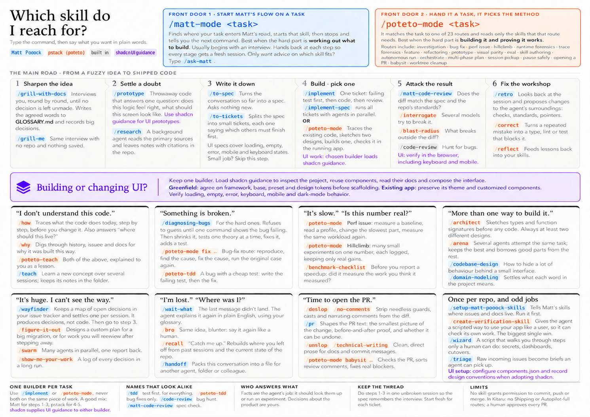

# skills.md

My skills and adapted skill packs, with reviewable updates from other authors.
The first pack is [Lauren Tan's pstack](https://github.com/cursor/plugins/tree/main/pstack).
Only the `pstack` folder is imported from `cursor/plugins`. The second pack is
[Matt Pocock's skills](https://github.com/mattpocock/skills), tracking its `skills/`
directory and MIT license, with 27 published skills installed.

See [the combined workflow](docs/combined-workflow.md) for the one-pager setup,
`matt-mode`, and the distinct teaching, TDD, and review commands.



## Use the skills in T3 Code

From the project directory on the machine running your T3 Code agent:

```sh
npx skills@latest add hamzamogni/skills.md --skill '*' --agent codex
```

For Claude, use `--agent claude-code`. To install for both providers, use
`--agent codex claude-code`. Restart the agent session in T3 Code, then select
`$poteto-mode` or `$matt-mode`. Install the full collection because the modes call
other skills. Do not use `--full-depth`, which also searches the raw snapshots.

This private repository requires GitHub access through Git, authenticated `gh`,
or SSH. The CLI requires Node.js 22.20 or newer. Codex receives project skills in
`.agents/skills`; Claude receives them in `.claude/skills`. Runtime guidance and
license notices are bundled inside the installed skills. No source checkout is
needed to use them. Add `--global` for a deliberate user-wide installation.

Installed skills are copies. After you approve and merge an upstream adaptation,
run `npx skills@latest update -p` in the project to refresh its existing skills.
Rerun the full `add` command to include newly added skills. The CLI can overwrite
same-named installed skills; move any personal edits into this repository first.
See [installation and migration](docs/combined-workflow.md#install-and-set-up-a-project).

The pstack pack keeps 52 skills and builds on
[p3-stack's native T3 port](https://github.com/uzairansaruzi/p3-stack).
Delegation, model roles, PR watches, scheduling, history, and runtime proof use
T3 instructions. Cursor scripts stay in the raw snapshot and are excluded from
installation. Start with `setup-pstack` to choose model roles, or let unspecified
roles inherit your parent model. Pstack's teaching and TDD commands are now
`poteto-teach` and `poteto-tdd`; Matt's are `teach` and `tdd`.

Read [the port and tool mapping](docs/t3-port.md) and the
[T3 runtime contract](skills/pstack/poteto-mode/references/t3-runtime.md).
Static checks and skill discovery do not establish live T3 behavior; use the
[smoke checks](docs/t3-smoke.md) when changing native workflows.

See T3 Code's [composer docs](https://github.com/pingdotgg/t3code/blob/main/docs/user/composer.md)
and [Claude skill discovery](https://github.com/pingdotgg/t3code/blob/main/docs/user/providers-claude.md#skills).

## Make it yours

Edit `skills/pstack/<skill>/SKILL.md` to adapt an imported skill. Create personal
skills at `skills/<your-skill>/SKILL.md`, with `name` and `description` frontmatter.
The install command includes both personal skills and imported packs.
Skill names must be unique across the installed collection.

Run `python3 scripts/package_skills.py build` after changing shared guidance or
license notices, then `python3 scripts/skills.py validate`. Edit the source files
listed in `bundles.json`; generated per-skill copies must match those sources.
The Python `install` command remains available for development links to a local
checkout, where edits are reflected directly.

## Review upstream updates

GitHub Actions checks each source every six hours, at minute 23 UTC. Changed
selected content creates a source-specific PR requesting `hamzamogni`'s review. GitHub delivers the
review notification through your account's web, mobile, and email settings.
Enable review-request notifications in [GitHub notification settings](https://github.com/settings/notifications)
if you want email. A notification is requested; email delivery depends on those settings.

The workflow opens one pull request per source at a time. It waits for your review
before proposing further updates. It never merges a PR or changes your editable
skills. Changes elsewhere in `cursor/plugins` do not create update PRs.
Use **Actions → Check upstream skills → Run workflow** for an immediate check.
Scheduled runs can be delayed by GitHub. Inactive public repositories can have
schedules disabled; this repository starts private.

For the merge steps, read [Review and merge an update](docs/upstream-updates.md).
The workflow uses `GITHUB_TOKEN`; no personal token is required. The repository
must allow Actions to create pull requests in **Settings → Actions → General →
Workflow permissions**. That setting is enabled during initial setup.

## Repository layout

| Path | Purpose |
| --- | --- |
| `skills/` | Editable pstack adaptations and personal skills |
| `upstream/<source>/` | Unmodified selected snapshots, including MIT licenses |
| `sources.json` | Repository, branch, subtree, and reviewer for each source |
| `sources.lock.json` | Commit and subtree hash of each imported snapshot |
| `adaptations.lock.json` | Upstream revision used as each adaptation's merge base |
| `ports/` | File mappings, accepted source hashes, and pinned T3 tool inventory |
| `bundles.json` | Shared runtime guidance and notices copied into each skill |
| `scripts/` | Import, three-way merge, validation, installation, and PR creation |

Repository maintenance requires Python 3.10 or newer and Git. Automated PR creation also uses GitHub
CLI, which is available on GitHub's Ubuntu runners. Run the behavior tests with
`python3 -m unittest discover -s tests -v`.
Run `python3 scripts/check_npx.py --codex-parser` for disposable CLI installs,
file and link checks, migration from old checkout links, and Codex discovery.
Omit `--codex-parser` when Codex is unavailable.

Additional authors can be added to `sources.json` with a separate source name and
an explicit subtree. Source packs must include a license. Import with
`python3 scripts/skills.py init <source>` to create its snapshot, editable copy,
and merge base. Packs can use nested skill categories. Each new pack needs its own runtime
adaptation and a reviewed port map.

Imported pstack material is copyright 2026 Lauren Tan and licensed under
[MIT](upstream/pstack/LICENSE). The editable pack retains her notice and Uzair
Ansar's T3 adaptation notice in [its license](skills/pstack/LICENSE).
Matt's pack retains his [MIT notice](skills/matt-pocock/LICENSE). The three local
helpers are authored here rather than imported from either pack.
Original code and documentation in this repository are reserved to the author
unless a separate license is added.
